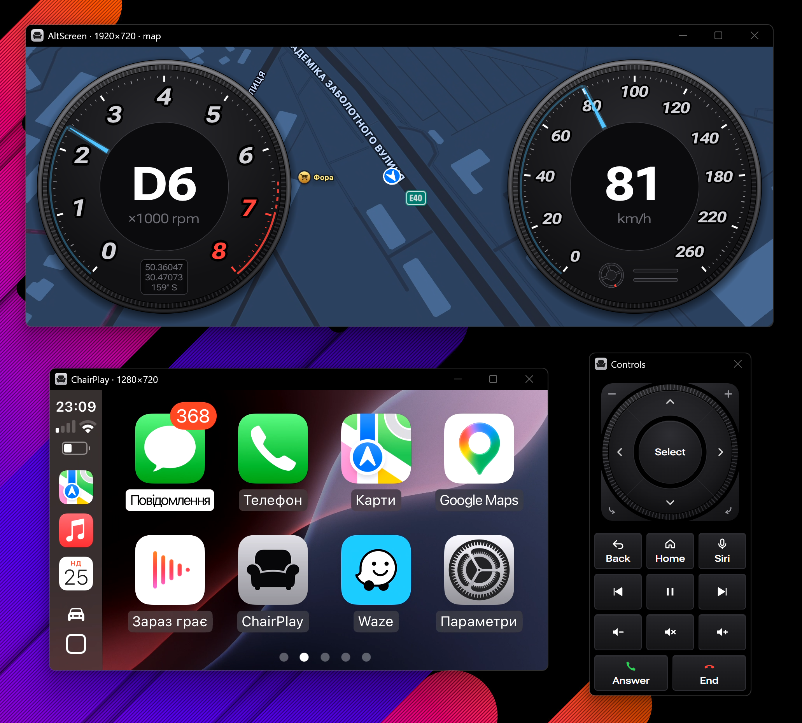

# ChairPlay

**Wireless Apple CarPlay on your Windows PC.** Listen to music, use navigation, take calls and talk to Siri through
your PC's speakers and microphone. Control CarPlay with your mouse and keyboard.



Useful for building and testing CarPlay apps and navigation without a car, for demos, or just CarPlay on a desk.

ChairPlay is built on [DiPlay](https://github.com/shihabal3amri/DiPlay) by shihabal3amri, a CarPlay receiver for
Android car head units, which is based on [xcertplay](https://github.com/shilapi/xcertplay) by shilapi. It is a
separate project, not affiliated with their authors or with Apple.

## What you need

- **An iPhone** with CarPlay.
- **A Windows 10 or 11 PC (64-bit)** with Bluetooth and Wi-Fi. A USB Bluetooth adapter works if it supports classic
  Bluetooth, not only Bluetooth Low Energy.
- **One Wi-Fi network for the PC and the iPhone.** The PC must be on Wi-Fi, not only on a cable. The network must let
  devices see each other: most home networks do, guest networks usually don't. It must use WPA2 or no password;
  WPA3-only networks don't work yet.
- **An Apple MFi identity**, a certificate and key that let the iPhone accept an accessory. ChairPlay doesn't include
  one and can't: you supply your own. [The setup guide](docs/SETUP.md) shows where the files go.

## Get started

1. **Install.** Download the latest `ChairPlay-…-setup.exe` from the
   [Releases page](https://github.com/NumberOneBot/ChairPlay/releases) and run it. No administrator rights needed.
   If Windows SmartScreen warns about an unrecognized app, choose **More info → Run anyway**.
2. **Pair your iPhone** with the PC once, in Windows Settings → Bluetooth & devices, as you would headphones.
3. **Open ChairPlay.** The **Get started** screen checks everything for you: the MFi files (it shows the folder to
   put them in), the firewall (it adds the rule with your permission), your paired iPhone and your Wi-Fi network. Each
   step ticks off as soon as it's ready.
4. **Unlock your iPhone and tap Allow** when it asks. CarPlay comes up.

After that, open ChairPlay with your iPhone unlocked and nearby, and CarPlay starts by itself.

A newer installer updates ChairPlay and keeps your settings, pairing and MFi files. Uninstalling asks whether to
delete them too.

## Features

- CarPlay in a resizable window; the mouse works as touch.
- Keyboard controls like a car's knob and buttons (see [Controls](#controls)), and on-screen car controls from the
  toolbar's Controls button.
- Sound and microphone on the devices you choose, with a volume separate from Windows'.
- **AltScreen** (experimental): a car's instrument cluster as a second CarPlay screen in its own window, with the
  map, the turn card or both, in a preset part of the cluster or a rectangle you draw. It can also show a **HUD**: the
  next turn with animated 3D maneuvers, the distance, the arrival time and the song.
- **GPS spoofing** (experimental): the iPhone navigates by a virtual car you drive with the keyboard or a gamepad.
  The optional [satellite reports](docs/GPS.md) predict the sky at the car's position from a downloaded GPS almanac.

Settings are in the app and save as you change them. Tested on Windows 11 with an iPhone 15 (iOS 18.6).

## Controls

| Key                                          | Does                                                          |
| -------------------------------------------- | ------------------------------------------------------------- |
| Mouse                                        | touch                                                         |
| Arrows                                       | tilt the knob: move the focus                                 |
| Tab / Shift+Tab, mouse wheel                 | turn the knob                                                 |
| Enter, Space                                 | select                                                        |
| Backspace, Esc                               | back                                                          |
| Home                                         | home screen                                                   |
| Ctrl+R                                       | reconnect                                                     |
| S                                            | Siri                                                          |
| F3 / F4                                      | answer / end a call                                           |
| F7 / F8 / F9                                 | previous track / play or pause / next track                   |
| F10                                          | drive the GPS car with the arrows (GPS spoofing on)           |
| Shift+F10                                    | large or small gauges for the GPS car                         |
| F11                                          | AltScreen: switch between the HUD and the map                 |
| Shift+F11                                    | AltScreen: move the arrival time and turn card                |
| F12                                          | save screenshots of CarPlay and the AltScreen                 |
| Ctrl+Up / Ctrl+Down / Ctrl+M                 | ChairPlay's volume up / down / mute                           |
| Mouse wheel over the AltScreen, + / −        | zoom the AltScreen map                                        |
| The car button on the CarPlay home screen    | open the settings; the CarPlay button or Esc returns          |

Change any key on the Keyboard page.

## Good to know

- Close ChairPlay with its window. If it's killed mid-session, from Task Manager for example, the iPhone may ignore
  new connections until you restart the iPhone.
- It works over Wi-Fi only, not over USB or a hotspot shared by the PC.
- Calls sound best with headphones. Echo cancellation for speakers is experimental and off by default.
- Music comes over Wi-Fi as AAC; the iPhone doesn't send lossless audio this way.
- The iPhone's volume buttons don't change CarPlay's volume. Use ChairPlay's volume or Windows'.

## Report a problem

Open an [issue](https://github.com/NumberOneBot/ChairPlay/issues/new): About → **Report a problem** fills in the
version for you. For a connection problem, set **Log level** to **Info** on the Experiments page, try again, and
attach the log: the **Logs** button on that page opens its folder. ChairPlay keeps your Wi-Fi password out of the log,
but look it over before sending.

Ideas and fixes are welcome too: open an issue or a pull request, or write to me at
[alex.strelets@gmail.com](mailto:alex.strelets@gmail.com).

## Build it yourself

You need JDK 17; the build downloads the rest.

```
git clone --recursive https://github.com/NumberOneBot/ChairPlay.git
cd ChairPlay
gradlew deploy
```

This builds the app into `dist\ChairPlay`. [docs/SETUP.md](docs/SETUP.md) covers the build, every setting, moving to
a newer DiPlay, and the git hooks that keep keys out of commits.

## Licence and credits

GPL-3.0, like DiPlay and xcertplay; see [LICENSE](LICENSE). The CarPlay protocol work is DiPlay's and xcertplay's.
The HUD's 3D maneuvers and destination flag are LuKa's, from
[mib2q-carplay-rgi](https://github.com/luka-dev/mib2q-carplay-rgi) (GPL-3.0 or later);
[native/maneuver/README.md](native/maneuver/README.md) lists what was taken and changed. The notices of the bundled
libraries are in `THIRD_PARTY_NOTICES` and come with the app.

CarPlay, iPhone, AirPlay and Siri are trademarks of Apple Inc. ChairPlay is not affiliated with Apple and does not
include any Apple MFi identity.

## Support the project

ChairPlay is a hobby project, built and tested on real hardware in my spare time. If it saves you a trip to the car or
helps your CarPlay work, you can buy me a coffee:

<a href="https://www.buymeacoffee.com/alexstrelets"></a>
