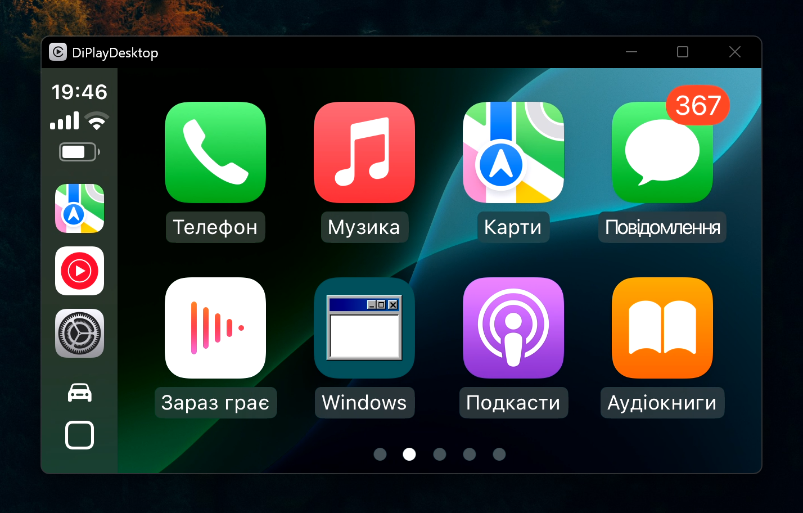

# ChairPlay

**Wireless Apple CarPlay on a Windows PC.** Your iPhone connects to the PC the way it connects to a car: over
Bluetooth first, then over Wi-Fi. CarPlay opens in a window, and you drive it with the mouse and the keyboard,
hear it through the PC's speakers and talk to Siri through its microphone.



Useful for developing and testing CarPlay apps and navigation without sitting in a car, for demos, or simply for
CarPlay on a desk.

ChairPlay is built on [DiPlay](https://github.com/shihabal3amri/DiPlay), the Android CarPlay receiver for head
units by shihabal3amri. It compiles DiPlay's portable CarPlay core (AirPlay, iAP2, MFi authentication) from the
`upstream/` submodule and adds everything Windows needs around it. It is a separate project, not affiliated with or
endorsed by DiPlay's authors or by Apple.

## What works

- **Wireless CarPlay** with an iPhone on the same Wi-Fi network as the PC, started over Windows Bluetooth.
- **Get started** before the first connection: four steps the app checks on its own (the MFi files, the firewall,
  which it lets ChairPlay through with your consent, the paired iPhone, and the Wi-Fi network, filled in with the one
  the PC is on), each ticking itself once it is done.
- **Settings** in the window whenever CarPlay is not on it: a toolbar with CarPlay, the AltScreen and controls
  windows, where the connection stands, and Connect, or Reconnect and Disconnect; and pages for the connection, the
  CarPlay screen, the AltScreen, the keyboard, audio, and about. Each change is saved into `settings.properties` or
  `controls.properties` in place and says when it applies; what is wrong shows above the settings, with what to do.
- **Video** in a resizable window, 800×480 at 60 fps by default, H.264 decoded in software.
- **Touch** with the mouse: taps, drags, scrolling lists and the map.
- **Car controls on the keyboard**: arrows tilt CarPlay's knob, Tab turns it, Enter selects, Esc goes back, plus
  media keys, call keys and Siri. Every binding can be changed on the Keyboard page, and applies at once.
- **Audio**: music (AAC-LC 48 kHz stereo), navigation prompts and Siri, on the device you choose.
- **Microphone** for Siri and calls (Opus), on the device you choose.
- **Your own "car"**: the name the iPhone shows, the icon and label of the car button on the CarPlay home screen
  (ChairPlay's armchair by default; tapping it opens the settings).
- **The CarPlay screen as you want it**: resolution (which decides whether iOS draws at @2x or @3x, and how much
  fits on the screen), frame rate, light or dark theme following Windows, driving side, dock position, safe area,
  corner style.
- **AltScreen** (experimental): the car's instrument cluster as a second CarPlay screen in its own window,
  1440x540 like Audi's Virtual Cockpit by default, with the map, the turn card or both, switched on the fly.
- **HUD** in the AltScreen window (`altscreen.content=hud`): the next maneuver, the distance to it, the arrival
  and the song on black, drawn by the app itself rather than by the iPhone. The animated 3D maneuvers (turns,
  roundabouts with their roads, the arrow filling toward the turn, the destination flag) are LuKa's maneuver
  renderer from the [MHI2Q CarPlay project](https://github.com/luka-dev/mib2q-carplay-rgi), ported to run
  inside the app's window.
- **On-screen car controls** (`window.controls=true`): a window of buttons for the knob, back, home, Siri, media,
  volume, calls and the AltScreen's zoom and modes, held as long as the mouse holds them; Alt shows their keys.
- **Volume of its own**: Ctrl+Up, Ctrl+Down and Ctrl+M turn ChairPlay up, down or mute it, leaving Windows' volume
  alone.
- **Graceful reconnection**: close the window and start again, and the iPhone reconnects by itself.

Tested on Windows 11 with an iPhone 15 (iOS 18.6).

## Requirements

- Windows 10 or 11, 64-bit.
- **Bluetooth**: a built-in or USB adapter with Bluetooth Classic (BR/EDR), on Windows' own Microsoft Bluetooth
  stack: the app opens the iPhone's iAP2 channel over RFCOMM through Winsock. Bluetooth LE-only adapters and
  third-party stacks (old Broadcom WIDCOMM, Toshiba) do not work. The iPhone must be paired in Windows Settings.
- **Wi-Fi**: the PC itself must be on Wi-Fi, through its own Wi-Fi adapter, on the same network as the iPhone; a PC
  wired to the same router by Ethernet is not enough yet. The network must be WPA2-Personal or open (a WPA2/WPA3
  mixed router works as WPA2; WPA3-only does not), and must let its clients reach each other and pass multicast
  for Bonjour: no client or AP isolation, which guest networks usually have. Tested on 5 GHz.
- **Windows Firewall** must let the iPhone in (Get started adds the rule with your consent, or gives the commands).
- **Microsoft Edge WebView2** for the settings and Get started: part of Windows 11 and of an updated Windows 10.
  Without it they open in the default browser instead.
- **An Apple MFi accessory identity** (certificate and private key). The iPhone authenticates every CarPlay
  accessory; this project does not and cannot ship one. You supply your own in `offline-mfi\`.
- JDK 17 to build. The build downloads the rest itself (zig, Node.js for the screens, the WebView2 SDK), each
  pinned and checked.

## Quick start

```
git clone --recursive https://github.com/NumberOneBot/ChairPlay.git
cd ChairPlay
gradlew deploy
```

`deploy` builds a self-contained app (with its own Java runtime) into `dist\ChairPlay` and keeps your
settings and keys there on later builds. To install it elsewhere, pass `-Pchairplay.home=<folder>`, or put
`chairplay.home=<folder>` in `%USERPROFILE%\.gradle\gradle.properties` once. Then:

1. Pair the iPhone in Windows Settings > Bluetooth & devices.
2. Put your MFi identity files in `dist\ChairPlay\offline-mfi\`.
3. Start `ChairPlay.exe`. Get started checks each step on its own: the MFi files, the firewall rule (Add the rule
   adds it with your consent), the paired iPhone, and the Wi-Fi network and its password (or fill them into
   `dist\ChairPlay\settings.properties`, which `deploy` wrote with every setting at its default).
4. Once every step is done, press Connect with the iPhone unlocked, and accept CarPlay on it; CarPlay then covers
   the window.

[docs/SETUP.md](docs/SETUP.md) has every step in detail and the reference for all settings.

## Controls

| Key | CarPlay |
| --- | --- |
| Mouse | touch |
| Arrows | tilt the knob: focus moves in that direction |
| Tab / Shift+Tab | turn the knob one step forward / back |
| Mouse wheel | turn the knob, one step per notch |
| Enter, Space | select |
| Backspace, Esc | back |
| Home | home screen |
| F7 / F8 / F9 | previous track / play-pause / next track |
| F3 / F4 | answer / end a call |
| S | Siri |
| F12 | screenshots of the CarPlay screen and the AltScreen, at the iPhone's resolution, into `screenshots` |
| Ctrl+R | end the session gracefully and connect again |
| F11 | AltScreen: map, turn card, map with turn card |
| Shift+F11 | AltScreen: move the ETA and turn card (auto, left, right, top, off) |
| Mouse wheel over the AltScreen, + / − (either keyboard) | zoom the AltScreen map |
| The car button on the CarPlay home screen | the settings; the CarPlay button or Esc returns to CarPlay |

While the settings cover the window, the keys and the mouse are theirs, not CarPlay's.

Rebind any of them on the Keyboard page, which saves them into `controls.properties` and applies them at once; Esc
always goes back and Enter always selects.

## Configuration

Everything lives next to the exe, in plain text:

- `settings.properties`: Wi-Fi, the iPhone, connecting at start and showing CarPlay at once, the car's name and
  icon, sound devices and call echo cancellation, and the CarPlay screen (size, frame rate, physical size, theme,
  driving side, dock, safe area, corners) and window size. The settings change these in place, keeping the file's
  comments and the other lines.
- `controls.properties`: key bindings and mouse-wheel behaviour, which the Keyboard page changes the same way.
- `window.properties`: where you left the windows and their sizes, and whether Get started is done, written by the
  app.

A wrong value stops the start with the setting named, and the console prints what the iPhone was told.

## Good to know

- Quit by closing the window. If the app is killed mid-session (Task Manager), the iPhone may ignore new sessions
  until it is restarted.
- Wireless only, and only over a Wi-Fi network shared by the PC and the iPhone (no PC hotspot, no USB).
- Echo cancellation for calls is experimental and off by default (`audio.echo.cancellation`); headphones are the
  safe choice for calls.
- Over Wi-Fi the iPhone sends music only as AAC; lossless formats are refused.
- The iPhone's own volume buttons do not change CarPlay's volume; Windows' volume does, as a car's knob would.

## Roadmap

- A macOS (Apple Silicon) version, built from source.
- Replaying recorded GPS tracks into the iPhone, so its navigation apps follow a route from the desk.

## Building on DiPlay

DiPlay is a git submodule pinned to the version this build is tested with. To move to a newer DiPlay:
`git -C upstream fetch`, `git -C upstream checkout <commit>`, run `gradlew test`, and commit the new pointer.
[docs/SETUP.md](docs/SETUP.md) describes the mirror script that keeps the build working without DiPlay's
repository, and the git hooks that keep keys out of commits.

## Licence and credits

GPL-3.0, as DiPlay; see [LICENSE](LICENSE). The CarPlay protocol work is DiPlay's. The HUD's maneuver renderer and
its destination flag are LuKa's, from [mib2q-carplay-rgi](https://github.com/luka-dev/mib2q-carplay-rgi) (GPL-3.0
or later); [native/maneuver/README.md](native/maneuver/README.md) lists what was taken and what was changed. The
bundled libraries' notices are in `THIRD_PARTY_NOTICES` and travel with the app.

CarPlay, iPhone, AirPlay and Siri are trademarks of Apple Inc. This project is not affiliated with Apple and does
not include any Apple MFi identity.

## Contributing

Ideas, bug reports and fixes are welcome. Open an issue or a pull request, or write to me at
[alex.strelets@gmail.com](mailto:alex.strelets@gmail.com) with what you would like to see. A log from the console
helps with anything that does not connect; the app leaves the Wi-Fi password out of it, but look it over before
sending.

## Support the project

ChairPlay is a hobby project, built and tested on real hardware in my spare time. If it saves you a trip to
the car or helps your CarPlay work, you can buy me a coffee:

<a href="https://www.buymeacoffee.com/alexstrelets"></a>
